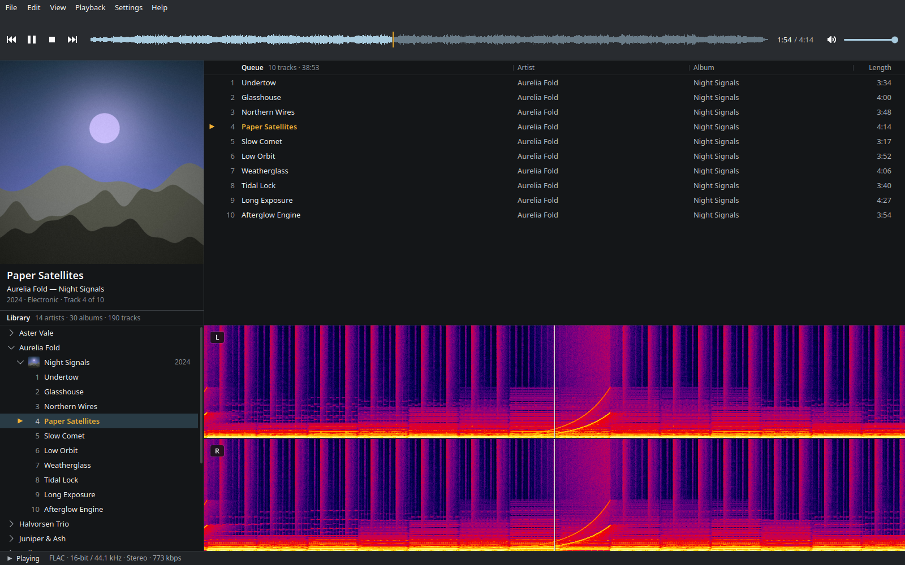
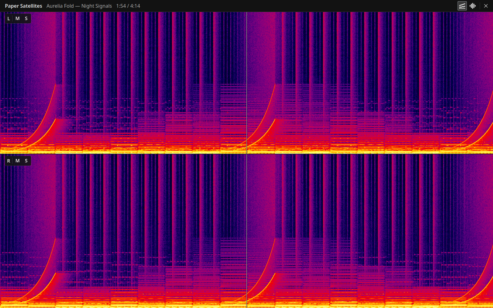

# Ferrous

A music player for KDE Plasma, made for listening closely.



Ferrous started as the player I wanted for my own music: one that feels at home on the Plasma desktop, stays quick however large the library grows, and lets me look into the music as well as listen to it. It is a personal project, but it is built with care, and it tries to do a few things very well.

## What Ferrous aims for

**At home on Plasma.** Ferrous should feel like it belongs next to Dolphin and Kate. It follows Breeze, your colour scheme and Plasma's animation settings, and it works with the desktop's media controls and media keys.

**Quick, always.** Playing, scanning, searching and analysing happen in the background, so the window keeps up with you. A stutter or a frozen moment is treated as a bug to fix, not something to live with.

**Made for looking closely.** A spectrogram, inspired by the spectral view of Adobe Audition, and a waveform show the music as it plays. You can zoom in, move around the track, read off what you see, or give the plot the whole screen.

**Careful with your files.** Your folders are the library, as they are on disk. When Ferrous changes a file, it shows you what will happen first and saves safely, so that a tag edit, a rename or new album art shouldn't cost you data.

## A look around

**Playback and the queue.** Gapless playback, repeat and shuffle, and a queue that comes back where you left it. Clearing, removing, moving and replacing tracks can be undone.

**Library and search.** The library follows your music folders as files come and go. [Search](docs/SEARCH.md) finds artists, albums and tracks as you type.

**The spectrogram and the waveform.** Follow the playhead or roam the track, compare channels, and inspect any moment under the crosshair.



**Tags and album art.** Edit the tags of many files at once, rename files from their tags, and find full-size album art in the iTunes catalog, which you can preview and compare with your current cover before applying it.

**Last.fm.** Scrobbling that stays out of the way, with a small progress bar in the status bar and a pause for when you'd rather not.

**Keyboard and accessibility.** Shortcuts you can change, keyboard use throughout, and names and states for screen readers.

The [feature guide](docs/FEATURES.md) goes into each part in more detail, with the supported formats.

## Where it stands

Ferrous is developed by one person, for Fedora with KDE Plasma first, and its direction follows my own priorities. I use it every day, and it is stable enough for that, but it is still growing: it lacks some features many players have, such as ReplayGain, an equalizer and a choice of output device. The [roadmap](docs/ROADMAP.md) lists what's missing and what I'd like to add. Feedback and contributions are welcome.

## Installation

Fedora RPM packages are on the [releases page](https://github.com/Tiaxi/ferrous/releases).

To build from source, install the prerequisites in the [installation guide](docs/INSTALL.md), then:

```bash
git clone https://github.com/Tiaxi/ferrous.git
cd ferrous
./scripts/run-ui.sh
```

## Documentation

- [Feature guide](docs/FEATURES.md): each part in detail, and supported formats
- [Installation guide](docs/INSTALL.md): dependencies, build options, data locations
- [Keyboard and mouse](docs/SHORTCUTS.md): shortcuts, scrolling and zooming
- [Search](docs/SEARCH.md): what search matches and how it ranks results
- [Development guide](docs/DEVELOPMENT.md): building, testing, debugging, profiling
- [UI design rules](docs/UI_DESIGN.md) and [visualization architecture](docs/VISUALIZATION_ARCHITECTURE.md)
- [Roadmap](docs/ROADMAP.md) and [contributing](CONTRIBUTING.md)

Under the hood, Ferrous pairs a Rust backend for playback, the library, search and analysis with a Qt 6 and KDE Kirigami interface, on GStreamer and SQLite.

## License

[GNU General Public License v3.0](LICENSE).
