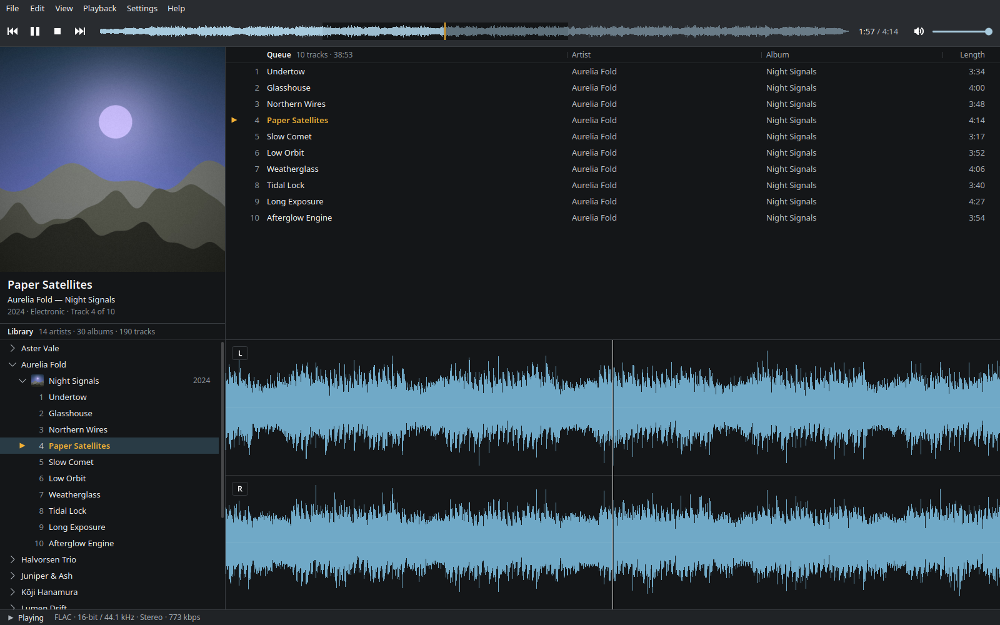
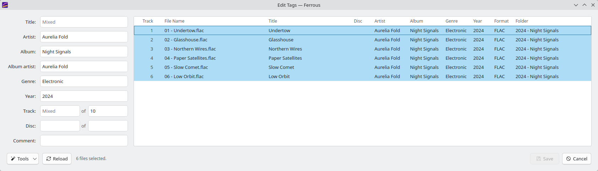
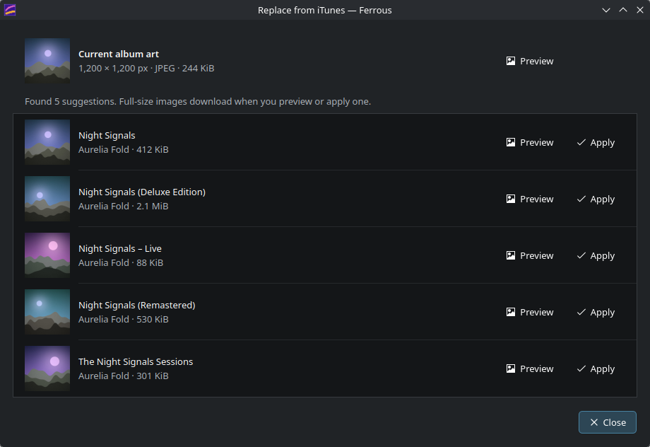

# Feature guide

What each part of Ferrous does, in more detail than the [README](../README.md). For keys and mouse gestures, see [keyboard and mouse](SHORTCUTS.md); for search syntax, see [search](SEARCH.md).

## Playback

- GStreamer plays the queue with seeking, repeat, shuffle and volume. A track goes on gaplessly into the next one when their file name extensions match, such as two `.flac` files.
- The queue comes back on the next launch, with the current track where you left it.
- Clearing the queue, removing, moving or replacing tracks can be undone and redone until the queue changes another way ([details](SHORTCUTS.md#library-and-queue)).
- **Play Next** marks queue tracks to play after the current one, in the order you mark them, without moving them and without turning shuffle off ([details](#play-next)).
- **Find in Queue** finds tracks in the queue alone, then plays one without replacing the queue or marks it to play next ([details](#find-in-queue)).
- Open files, add folders, import M3U and M3U8 playlists, and drag tracks to reorder them.

## Play Next

Play Next marks tracks in the queue to play next without moving them. With the whole library in the queue and shuffle on, mark the rest of an album, and its tracks play after the current one; then shuffle carries on.

- **Marking.** Press Q, or choose **Play Next** in the queue's context menu, to mark the selected tracks. They join the end of the marked tracks in the queue's order, and each row shows its place among them. Q on tracks that are all marked unmarks them, as **Don't Play Next** does; with some marked, Q marks the others and leaves the marked ones in their places. **Edit › Clear Play Next** unmarks them all.
- **Playing.** The first marked track plays when the current one ends, and Next goes to it too, gaplessly where the tracks allow. A track is unmarked as it starts, also when you play it yourself. The current track can be marked as well, to play it again next. Marked tracks play also with Repeat One on.
- **After the marked tracks.** With shuffle on, shuffle carries on, and the marked tracks count as played for its round. With shuffle off, the queue goes on from the last marked track that played. Previous goes back through the tracks that played, the marked ones too.
- **What stays.** Marks follow their rows when tracks move or are removed, and a file in the queue twice is marked only in the row you chose. Stop, and playing another track yourself, keep them. Marking isn't a change you undo, but undoing a removal or a replacement brings back the marks the tracks had. The marks come back with the queue on the next launch.
- **ReplayGain.** A marked track isn't a shuffle pick: [Auto](#replaygain) plays it at its album gain, also with shuffle on.

## Find in Queue

Find in Queue finds a track in the queue without scrolling through it, as Winamp's Jump to File did. With the whole library in the queue and shuffle on, it plays the track you find and shuffle carries on; global search would replace the queue instead.

- **Opening.** Press Ctrl+J, J while the queue has the focus, or choose **Edit › Find in Queue…**. It opens as global search's palette does, under the transport over a dimmed window, with its own title and placeholder.
- **Finding.** Type part of a title, artist, album, album artist, tag or file name. The query works as in [global search](SEARCH.md#find-in-queue), filters and quoted phrases too. The results are the queue's rows in the queue's order, each with its place in the queue. A file in the queue twice is found in both of its rows. The playing track's row shows the play glyph over its cover, and a row marked to play next shows its place among the marked rows, as in the queue.
- **Acting.** Enter, or a double-click, plays the row and closes the palette. The queue stays as it is, and so does shuffle: with shuffle on, the track counts as played for shuffle's round, which goes on after it, and Previous goes back to the track that played before. With shuffle off, the queue goes on from the track's row. Ctrl+Enter marks the row to [play next](#play-next), or unmarks it, and leaves the palette open for more. Alt+Enter selects the row in the queue, scrolls to it, gives the queue the keyboard and closes the palette; from there, every queue action works on that row. Esc closes the palette. Until you act, the queue's selection and scroll position stay as they were.
- **A queue that changes.** If the queue changes while the palette is open, such as when files are added from another program, the results follow their rows: a row that moved keeps its result, at its new place, and a removed row leaves the results. The query is then searched again for the queue as it is. A key pressed while a search runs acts on its results once they arrive, as in global search.

## ReplayGain

ReplayGain plays tracks at a similar loudness, from the gain tags in their files. Turn it on in the Playback page of Configure Ferrous; it is off by default, and off leaves the audio exactly as it was decoded.

- **Modes.** Track gain levels each track. Album gain levels each album and keeps its tracks as loud as each other, as they were mastered; a file without an album gain takes its track gain. Auto takes the album gain, and the track gain for each track that shuffle picks: an album you play in order keeps its levels, and shuffled tracks from different albums play alike. A track you pick yourself takes the album gain, also with shuffle on, and Repeat One keeps the choice. Auto decides for each track when it's picked and never changes the gain while a track plays.
- **Preamp and untagged files.** The preamp, from −15 to +15 dB, is added to every gain. Files without gain tags play at a gain of their own, 0 dB unless you set another.
- **Clipping.** Where a file's peak tag tells how loud its loudest sample is, the gain stays low enough for that sample not to clip. There is no limiter.
- **Where it changes.** Each track's gain starts with its first sample, also between gapless tracks and when Repeat One plays a track again. A seek keeps it, and a change in Configure applies at once. The gain is apart from the volume, which the volume slider, Plasma and MPRIS still set as before.
- **What you see.** The status bar shows the gain after the track's format, such as "ReplayGain −6.4 dB", and its tooltip tells how the gain was chosen, which gain Auto chose, and whether the peak lowered it. Configure can keep it to the tooltip. The waveform and the spectrogram show the file's own level, without the gain.
- **Tags.** Ferrous reads `REPLAYGAIN_*` tags in FLAC, Ogg Vorbis and Opus files, in the ID3v2 or APEv2 tags of MP3 files and in the iTunes tags of M4A files, and an Opus file's `R128_*` gains. WAV files and raw AC-3 and DTS files play at the gain for untagged files: GStreamer doesn't read a WAV file's ID3 tags, and Ferrous doesn't yet pass on the APEv2 tags of AC-3 and DTS files ([#806](https://github.com/Tiaxi/ferrous/issues/806)).
- **Tagging.** Ferrous doesn't measure loudness itself. A tagger such as [rsgain](https://github.com/complexlogic/rsgain) (`sudo dnf install rsgain`) writes the tags.

## Library

Your folder structure is the library: add one or more root folders in the Library page of **Settings › Configure Ferrous…**, and Ferrous shows them as a tree of artists, albums and tracks.

- **Watched folders.** Ferrous watches the roots, so files that other programs add, change or remove appear without a rescan, and it rescans the roots at startup.
- **Folders it can't watch** are rescanned every 30 minutes instead, and the Library page marks them: roots on network or FUSE file systems, network or FUSE mounts inside a root, and roots with more folders than `fs.inotify.max_user_watches` allows. Watching can be turned off there.
- **Removing a root** asks first and says how many tracks leave the library. The files stay on disk.
- **Search** spans the whole library, with ranked results in artist, album and track sections and `type:` filters. See [search](SEARCH.md).

## Spectrogram and waveform

The plot under the queue shows the playing track as a spectrogram or a waveform. The spectrogram is inspired by Adobe Audition's spectral view.

- **Modes.** Rolling scrolls continuously with playback. Centred shows a zoomable window around the playhead, held at the track's ends.
- **Spectrogram settings** (the Visualization page of Configure Ferrous): mono downmix or one lane per channel, a logarithmic or linear frequency scale, an optional limit to the audible band of high-resolution tracks (22.05 or 24 kHz), the dB range, and the FFT window size.
- **Waveform.** Zoom in to sample level, and inspect each channel.
- **Navigation.** Zoom with the wheel. A zoomed waveform, or a centred spectrogram that shows part of the track, can be dragged with the middle button to look at another part, or autoscrolled with a middle click; **View › Follow Playhead** (F) brings it back. A crosshair reads out the time and level under the pointer, and on the spectrogram the frequency too. See [keyboard and mouse](SHORTCUTS.md).
- **Fullscreen viewers** show the plot or the album art on their own.
- How the plot keeps up with playback, seeks and gapless transitions is in the [visualization architecture](VISUALIZATION_ARCHITECTURE.md).

## Tag editor

**Edit Tags** edits the tags of one or many files at once.

- A field whose files hold different values reads "Mixed" and keeps them as they are when you save. To clear it in every file on purpose, press Backspace or Delete in the empty field.
- **Auto Number** numbers the selected tracks.
- **Renaming files from their tags** lists each new name, and any that can't be used, before any file is renamed. Confirming renames only what the list showed, and nothing if that list no longer holds, for example because a file was moved or another name was taken since.
- Files are saved atomically: a failed save leaves the file as it was, and says why.

## Album art

- **Covers.** A folder's cover is its `cover`, `folder` or `front` image, in that order and in any letter case, or else its first JPEG or PNG image by name. The library and the now-playing view show the folder's cover before a track's embedded picture.
- **Changes on disk.** Covers follow images that are added, renamed, removed or replaced, at the next scan, or at once while the library watches its folders.
- **Replace from iTunes** searches the iTunes catalog for full-size album art. A suggestion can be previewed in the album art viewer and compared with the current art, then applied from there.

How applied artwork is written:

- It replaces the folder's named cover image in its current format, or adds a `cover.jpg` or `cover.png`, and leaves other images, such as back scans, untouched.
- In folders without such images, the artwork is embedded in every track there with the same album tag. Every one of them is checked first, and nothing is written unless all can be; a write that still fails is reported for its track.
- Ferrous keeps no copy of the art it replaces, so it asks before replacing a track's existing art.
- Suggestions go to the album they were searched for, even if playback moves on before you apply them. Nothing is written if that track's file was moved, renamed, deleted or changed since the search.

## Last.fm

Connect an account in the Last.fm page of Configure Ferrous; Ferrous authenticates through the browser.

- **Progress.** In the status bar, a short bar beside the Last.fm glyph fills with the time listened towards the scrobble. A seek doesn't move it, and only a new play starts it over; its tooltip gives the time left. When playback stops before the scrobble point, the bar keeps a mark where the play got to, and its tooltip says that play wasn't scrobbled.
- **Pause.** Clicking the slot pauses scrobbling until you click it again or quit, and strikes the glyph through. A track that plays while paused, before its scrobble point, is never scrobbled, and Ferrous starts no Now Playing updates or scrobbles until you resume; queued scrobbles wait.
- **Outages.** When Last.fm can't be reached or is busy, scrobbles stay queued, and Ferrous tries again on a schedule: after 30 seconds, then at doubling intervals of up to 30 minutes. A new scrobble or a Now Playing update that goes through can bring the next try forward. When Last.fm asks Ferrous to slow down, nothing is sent automatically until its wait is over, for at most a day, unless you reconnect the account.
- **Limits.** Last.fm takes no scrobble older than 14 days, so Ferrous discards queued scrobbles of that age, and the oldest beyond 10,000 queued ones. The Last.fm page counts those discarded since Ferrous started.
- **What you see.** The slot says when scrobbles wait or one failed, and the Last.fm page shows when the next retry is. Recent Issues lists only what needs you, such as reconnecting the account or scrobbles Last.fm refused. The diagnostics log records each Now Playing update, submission and failure. The Last.fm page can hide the slot.

## Desktop integration

- MPRIS media controls, so Plasma's media widget, the lock screen and media keys control playback.
- One instance: files opened from Dolphin or the command line replace the queue in the window that is already open.
- A `.desktop` file, an AppStream listing and MIME types for the formats below.
- Breeze, your colour scheme and accent, and Plasma's animation speed, including animations turned off.

## Supported formats

MP3, FLAC, M4A/AAC, Ogg Vorbis, Opus, WAV, AC-3 and DTS, and M3U/M3U8 playlists. What actually plays depends on the GStreamer plugins installed.

On Fedora, the base, good and bad-free GStreamer plugins that the RPM requires play every format above except AC-3 and DTS. Those need `gstreamer1-plugin-libav`, which the RPM recommends, so dnf installs it unless weak dependencies are turned off. Fedora builds that plugin against `ffmpeg-free`, which leaves out some codecs, such as E-AC-3. Replacing `ffmpeg-free` with the full FFmpeg from [RPM Fusion](https://rpmfusion.org/Howto/Multimedia) (`sudo dnf swap ffmpeg-free ffmpeg --allowerasing`) adds them. Ferrous does not require RPM Fusion.
